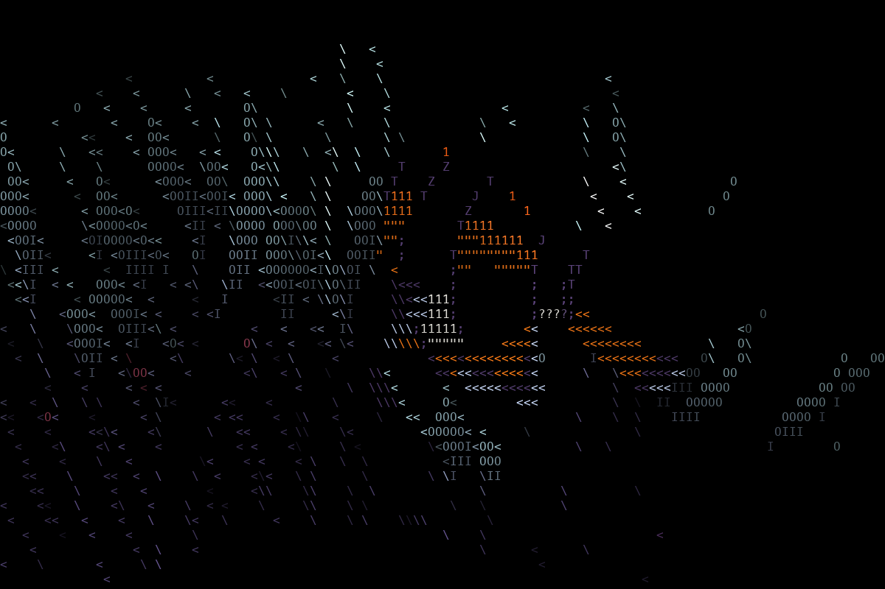
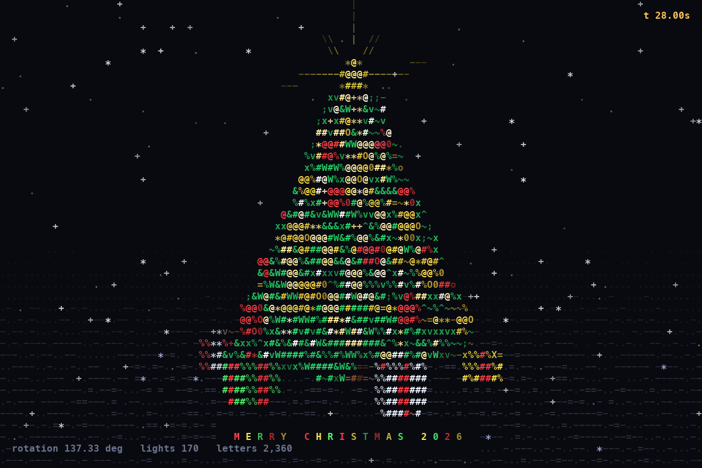

# ascii-art-collection

Live ASCII art for your terminal, drawn entirely with text characters, at any terminal size, and
re-fitted when you resize the window. Three arts, one command:

| | |
|---|---|
|  |  |
| `clownfish`: a clownfish swimming round a swaying anemone | `xmas-tree`: a rotating Christmas tree that grows in, lights up and spells a greeting |

`xmas-tree-v1` is the first terminal port of the tree, kept as it was.

Press any key to quit an art. Needs a terminal with truecolor (iTerm2, Ghostty, Kitty, WezTerm;
most others work in 256-colour mode).

## Install

With [uv](https://docs.astral.sh/uv/) (it fetches numpy for you):

```bash
uv tool install git+https://github.com/navarro165/ascii-art-collection
```

This puts four commands on your PATH: `ascii-art`, `clownfish`, `xmas-tree` and `xmas-tree-v1`.
To try it without installing: `uvx --from git+https://github.com/navarro165/ascii-art-collection ascii-art`.

## Use

```bash
ascii-art                      # a menu: arrows or j/k, Enter to run, 1-3 to pick, q to quit
ascii-art clownfish            # or name one; a unique prefix works (ascii-art clown)
ascii-art xmas-tree --glow 0.3 # options go straight through to the art
ascii-art --list
clownfish --seconds 30         # each art is also its own command
```

Options, per art (`ascii-art <art> --help` shows them too):

| option | clownfish | xmas-tree | xmas-tree-v1 |
|---|:-:|:-:|:-:|
| `--fps N` | 15 | 20 | 20 |
| `--speed X` | yes | yes | yes |
| `--aspect A` (cell height / width; detected, else 2.0) | yes | yes | yes |
| `--colors truecolor\|256` (default from `$COLORTERM`) | yes | yes | yes |
| `--seconds N` (quit by itself) | yes | yes | yes |
| `--mouse-exit` (mouse movement also quits) | yes | | |
| `--once` (grow in once, then keep rotating) | | yes | yes |
| `--no-hud` (hide the readout) | | yes | yes |
| `--glow S` (background glow, 0 = off, 1 = the original heavy halo; default 0) | | yes | |
| `--thin` (regular-weight glyphs instead of bold) | | yes | |

## How it adapts to size

Each art is a procedural 3D model projected onto a character grid whose size follows your
terminal. The clownfish camera is pinned to the short axis, so the fish keeps its detail at any
size and a bigger terminal simply shows more of the reef. The tree adds points as the grid grows.

## Development

```bash
uv run --group dev pytest                                 # frame parity, pty and menu tests
uv run --group dev python tools/make_images.py            # regenerate docs/images
```

`tests/test_parity.py` checks that every frame matches, bit for bit, what the original single-file
scripts produced. Each art also still runs on its own: `uv run --script src/ascii_art/arts/clownfish.py`.

## Credits

- **Clownfish**: derived from the clownfish scene in [ASCII Lab](https://github.com/sapozhkov/ascii-lab-public)
  (`01-clownfish`) by Alexandr Sapozhkov ([@ascii.lab](https://www.instagram.com/ascii.lab/),
  [the reel](https://www.instagram.com/reel/Df8L4ZnN4sX/)). The fish model, anemone simulation and swimmer are
  theirs; their composition was inspired by a photo by Nhobgood on Wikimedia Commons.
- **Christmas tree**: designed by [dwcminh.ascii](https://www.instagram.com/reels/DfoWsojSWA2/) in the "ASCII
  Christmas Tree" reel; the code is ported from [jaeyonni/XMasTree](https://github.com/jaeyonni/XMasTree),
  jaeyonni's Python recreation of that reel.
- **This repo** (navarro165): the live terminal renderers (any size, live resize, truecolor and 256-colour), the
  tree's v2 look (bold glyphs, solid gifts, depth shading, optional glow), the launcher, selector and packaging.

Neither upstream states a licence, so no licence is granted here for the derived parts. Authors: if you want
this taken down, credited differently or relicensed, open an issue and it will be done promptly.
